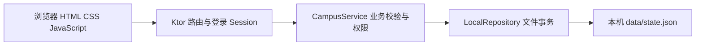
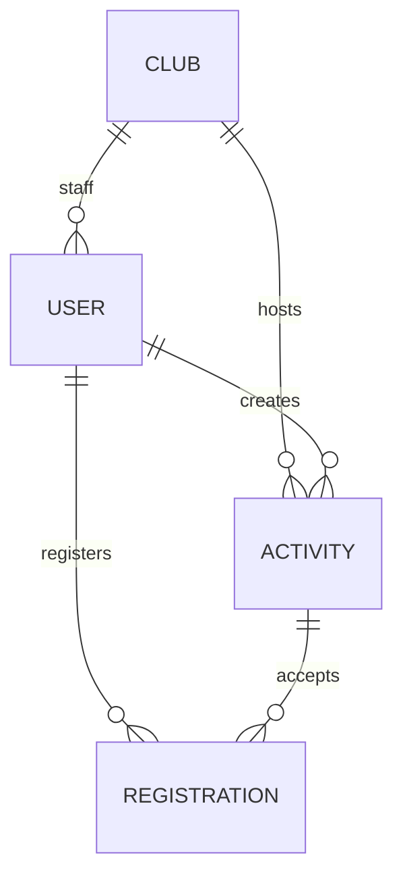
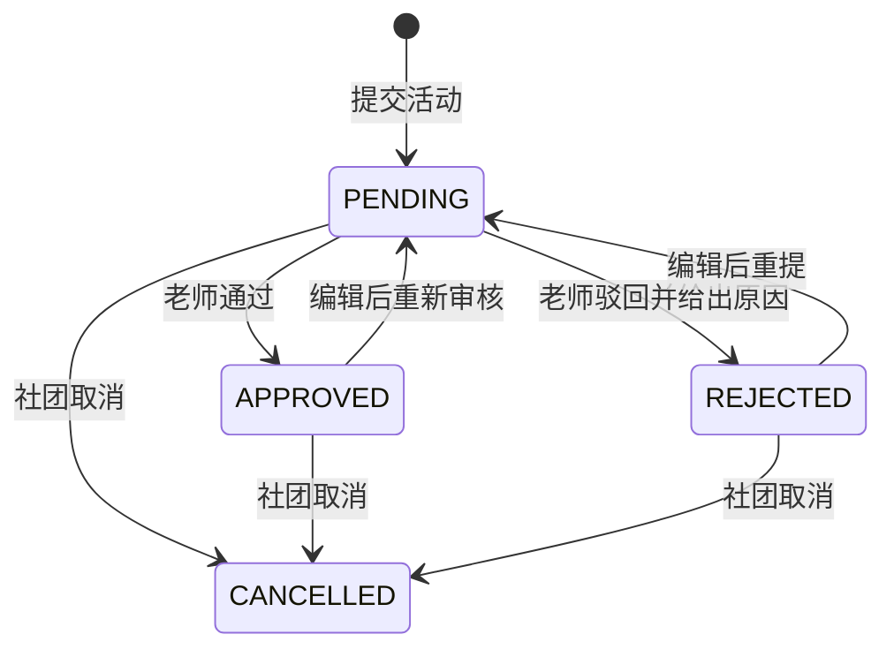

# 架构与接口约定

## 系统分层

所有页面与 API 使用同一个地址，浏览器通过相对路径 `/api/...` 请求。开发阶段默认监听 `127.0.0.1:8080`，前端不另开端口。

基础版保持一个 Gradle 工程。路由按角色拆分，模型和 repository 共用。v0.1 的业务规则集中在 CampusService，方便小组理解规则；正式并行开发前可以按成员职责拆成 StudentService、ClubService、ReviewService、AccountService，继续共用同一个 repository 实例和事务锁。不要为每个角色各建一份数据库或各启动一个服务。

## 数据关系

User 的 clubId 只对社团工作人员有意义。Activity 的 reviewerId 指向审核老师。Registration 使用 studentId、activityId 关联记录，业务层保证同一对组合不重复。参加条件在 v0.1 中只是文本说明，未实现自动资格筛选。

## 状态流转

驳回后的修改重提及已发布活动修改均转为待审核，已有报名保留；相关学生收到站内通知。取消不删除报名历史，学生可看到活动已取消。报名截止和满员由时间与人数动态判断，不额外保存成审核状态。

## API

请求和响应使用 JSON。错误返回 `{"message":"错误说明"}`。401 表示未登录或账号停用，403 表示角色/社团无权操作，400 表示输入错误，404 表示记录不存在，409 表示状态冲突。

| 方法 | 路径 | 权限 | 用途 |
|---|---|---|---|
| GET | /api/posts | 公开 | 已审核公告 |
| GET / POST | /api/club/posts | 社团负责人 | 查看、创建公告 |
| PUT | /api/club/posts/{id} | 所属社团负责人 | 修改公告并重新审核 |
| GET / POST | /api/teacher/posts、/api/teacher/posts/{id}/review | 教师 | 查看及审核待发布公告 |
| GET | /api/teacher/reviews、/api/admin/reviews、/api/club/reviews | 教师、管理员、所属社团 | 审核记录 |
| PATCH | /api/student/registrations/{id}/reminder | 报名学生本人 | 设置或关闭站内提醒 |
| GET | /api/health | 公开 | 本地健康检查 |
| POST | /api/auth/login | 公开 | 使用 username、password 登录 |
| POST | /api/auth/logout | 公开 | 清除登录 Cookie |
| GET | /api/auth/me | 已登录 | 当前有效账号 |
| GET | /api/clubs | 公开 | 社团选项 |
| GET | /api/activities?q= | 公开 | 已发布活动及搜索 |
| POST | /api/activities/{id}/registrations | 学生 | 报名 |
| GET | /api/student/registrations | 学生 | 自己的报名及活动状态 |
| GET | /api/club/activities | 社团工作人员 | 本社团全部活动 |
| POST | /api/club/activities | 社团工作人员 | 创建并提交待审核活动 |
| GET | /api/club/activities/{id}/participants | 所属社团工作人员 | 报名名单 |
| POST | /api/club/activities/{id}/cancel | 所属社团工作人员 | 取消活动 |
| GET | /api/teacher/pending | 老师 | 待审核活动 |
| POST | /api/teacher/activities/{id}/review | 老师 | approved、comment 审核结论 |
| PUT | /api/club/activities/{id} | 所属社团工作人员 | 编辑并重新提交审核 |
| GET | /api/activities/{id}/history | 已报名学生、所属社团、教师、管理员 | 查看修改记录 |
| GET / PATCH | /api/messages、/api/messages/{id}/read | 已登录 | 查看消息、标记已读 |
| GET / POST | /api/club/applications | 社团工作人员 | 查看及提交社团申请 |
| GET / POST | /api/teacher/club-applications、/api/teacher/club-applications/{id}/review | 教师 | 查看和审核社团申请 |
| GET | /api/teacher/staff、/api/admin/staff | 教师、管理员 | 负责人名单 |
| GET | /api/teacher/approved | 教师 | 已通过活动 |
| PATCH | /api/teacher/activities/{id}/end-time | 教师 | 设置结束时间 |
| GET | /api/admin/activities、/api/admin/activities/{id}/participants | 管理员 | 全部活动与报名名单 |
| GET | /api/admin/users | 管理员 | 账号列表 |
| POST | /api/admin/users | 管理员 | 创建账号 |
| PATCH | /api/admin/users/{id}/enabled | 管理员 | 修改 enabled |

社团编号从登录账号读取，不能靠请求体自选社团或角色。隐藏按钮只是界面展示，权限最终由服务端校验。登录后每次受保护操作都会重新读取账号状态，避免账号禁用后旧 Session 继续操作。

## 配置与数据维护

| 配置 | 默认值 | 说明 |
|---|---|---|
| HOST | 127.0.0.1 | 默认仅本机访问 |
| PORT | 8080 | 本地 HTTP 端口 |
| DATA_FILE | data/state.json | 相对于服务器启动目录；建议固定从项目根目录启动 |

备份只需在停服后复制 `data/state.json`。需要重置演示数据时，先停服并把现有文件备份移出，再启动，程序会生成初始数据。已有文件无法解析时会报错，程序不会自行清空重建。

当前仅支持单进程，不能让多个服务器实例同时写同一个 JSON 文件。以后迁移到数据库时保留服务层接口，将唯一报名约束和名额控制交给数据库事务实现。

## 扩展任务的接口草案

这些路径仅供讨论，当前不存在，不要直接当作可用 API：

- 二维码在浏览器中通过本地 qrcodejs 生成，链接格式为 `/?activity={id}`。
- 提醒由服务端定期检查并写入站内消息，服务器须在提醒窗口内运行。
- 公告提交及修改后需由教师审核，只有审核通过后公开。
